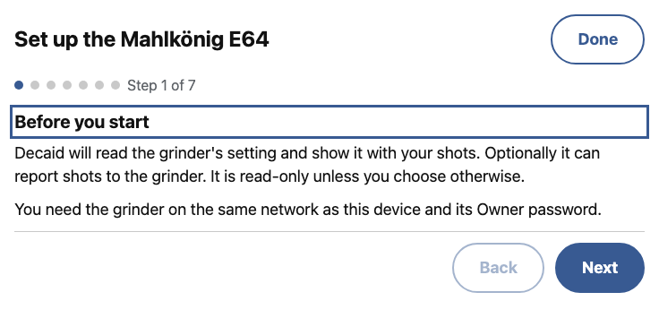
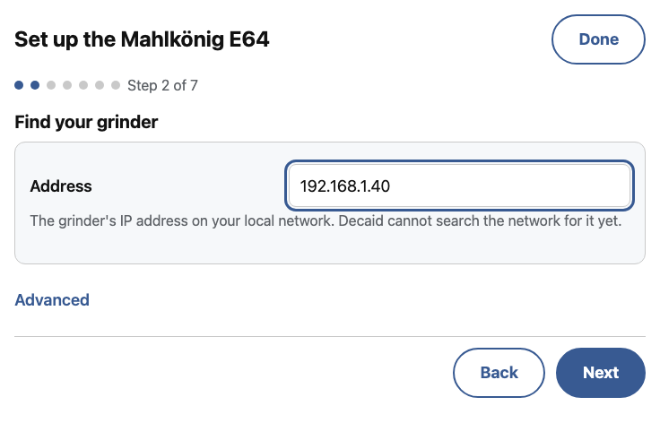
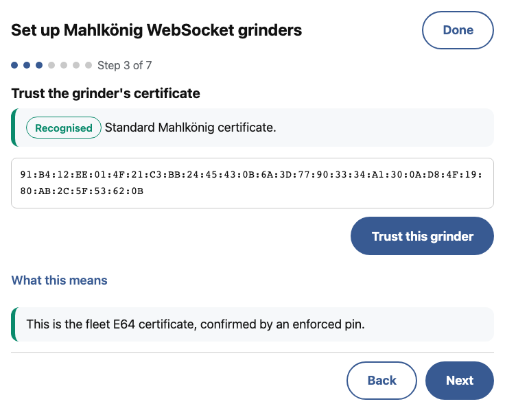
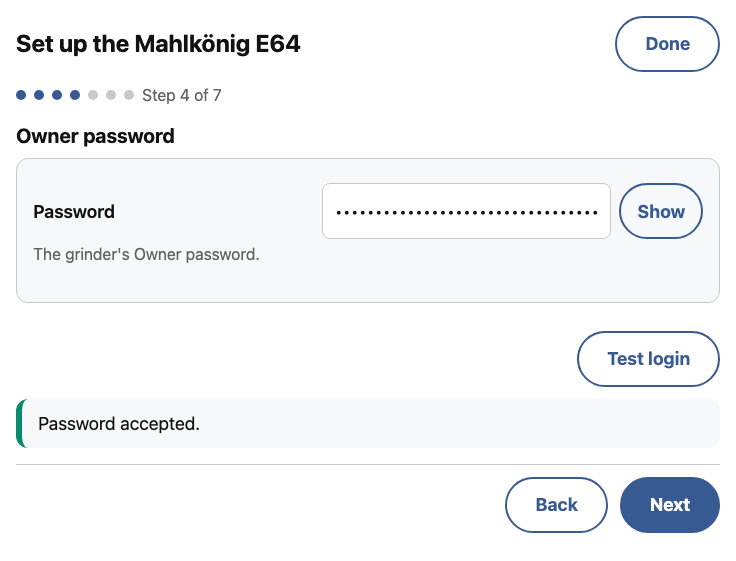
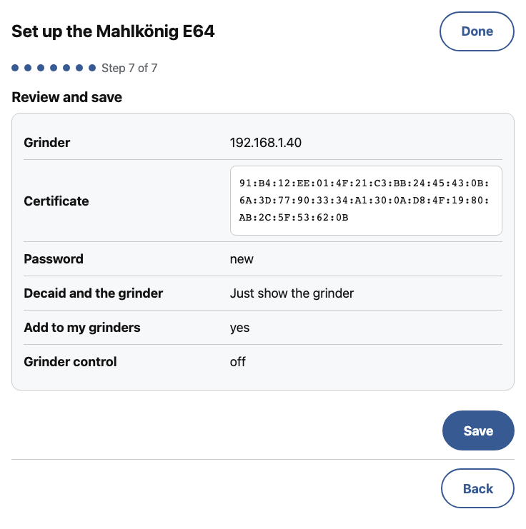
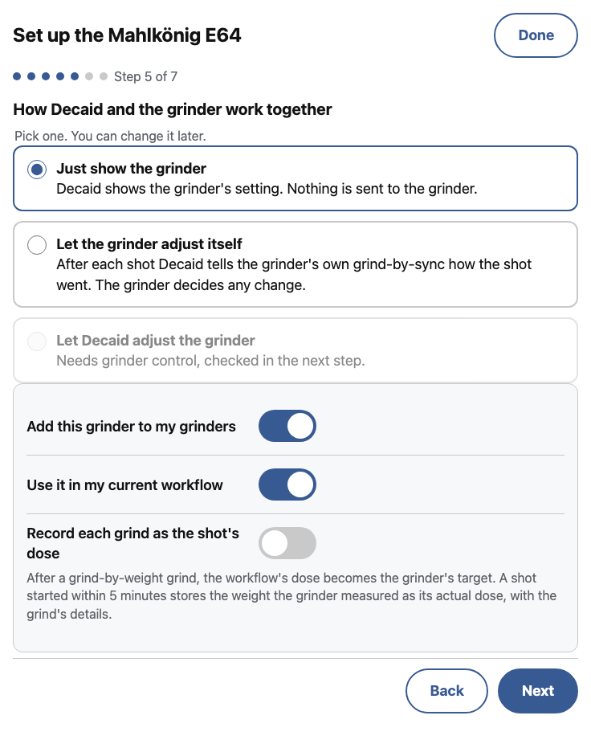
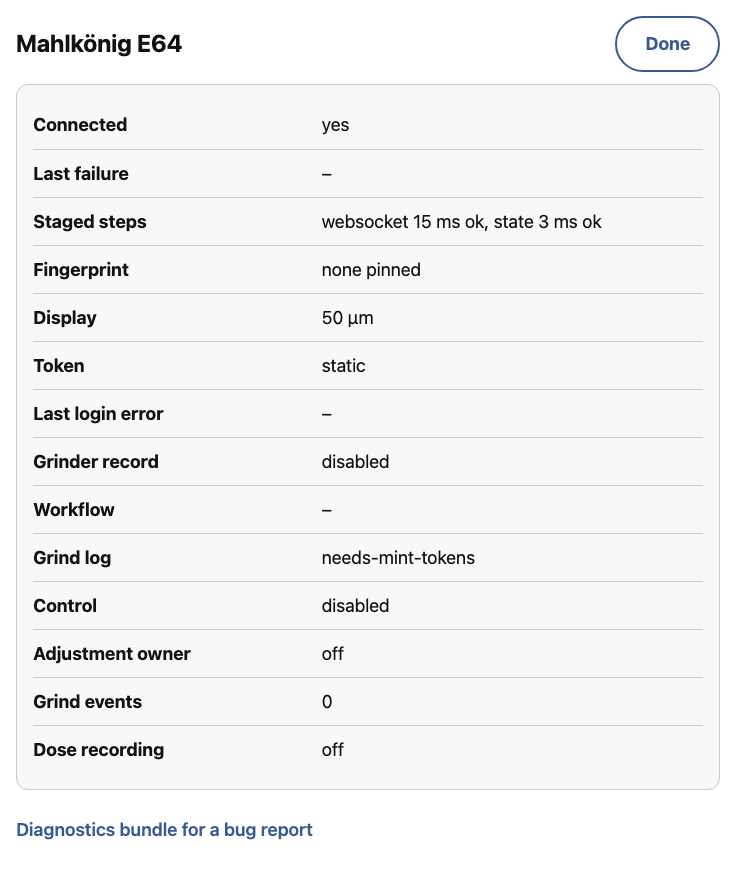
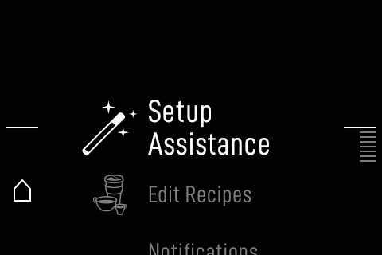
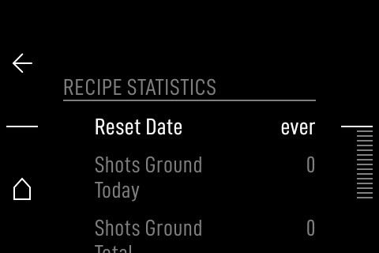

# Illustrated setup — Mahlkönig WebSocket grinders for Decaid

This is the walkthrough for getting a Mahlkönig grinder talking to Decaid: the
grinder's address, its certificate, an Owner password or a token, the settings
the plugin declares, and the two places that tell you it worked. The reference
material stays where it is — [README](../README.md) for behaviour,
[`CERTIFICATE_TRUST.md`](CERTIFICATE_TRUST.md) for TLS, [`DEBUG_MODE.md`](DEBUG_MODE.md)
for control.

**What the pictures are.** Every image below is a screenshot of a page this
plugin served during the capture run described in [`ASSETS.md`](ASSETS.md);
the grinder pictures are first-party renders of the grinder's own UI. Decaid's
own windows are **not** in this guide: the desktop app could not be built on the
capture machine (no Xcode) and no other target could be built either, so where a
step happens inside Decaid it is written as an exact click path rather than
shown. [`ASSETS.md`](ASSETS.md) records that, and the provenance of each image.

## 1. What you need

| Thing | Why | Where it comes from |
| --- | --- | --- |
| Decaid built from a commit that has the runtime-v2 Grinder observation contract, validated device surfaces and the plugin `notifications` permission | The plugin declares `notifications` and a read-only Grinder observation; the loader rejects older hosts | [README § Installation](../README.md#installation) names the upstream commits |
| The plugin installed and loaded | — | § 3 |
| The grinder on the same network as the Decaid host | The plugin refuses any address that is not loopback, private (RFC 1918), IPv6 ULA, link-local or `.local` | The grinder's Connectivity screen, or your router's client list |
| The grinder's address and, ideally, its Owner password | Login on `https://<grinder>:443` mints the WSS token | You set the Owner password on the grinder; the address is on its Connectivity screen |
| A Decaid session that can open **Settings → Plugins** | Where the plugin is enabled and configured | — |

Read-only is the default. Nothing below needs grinder control, a development
image, or a root shell.

## 2. The settings, by the names the manifest declares

`manifest.json` is the contract: Decaid only accepts a key the manifest
declares, keeps `"secure": true` keys in its secret store (the settings route
returns `{"isSet": true}` for them, never the value), and lists the rest in the
plugin's settings dialog. These are the fifteen keys `manifest.json` declares:

| Key | Label as declared | Type | Default | Notes |
| --- | --- | --- | --- | --- |
| `InstancesJson` | Grinder instances | string | `[]` | The grinder list. One object per grinder: `id`, `name`, `host`, `port`, optional `scheme` (`wss` or `ws`), `pollMs`, `certSha256`, `restPort`. |
| `TokensJson` | Grinder session tokens | string, **secure** | `{}` | `{"<id>":{"host":"<instance host>","token":"<token>"}}`. § 7. |
| `MintTokens` | Mint tokens on connect | enum `true`/`false` | `"false"` | With a password stored, the plugin logs in on every connect instead of reusing a static token. |
| `DebugLog` | Verbose connection diagnostics | enum `true`/`false` | `"false"` | Keeps the underlying error message and code of every connect stage in the staged log (`?read=stages`) and the diagnostics bundle (`?read=diagnostics`), instead of the stage, class and timing only. Secrets stay redacted at both levels. [`TROUBLESHOOTING.md`](TROUBLESHOOTING.md#the-staged-record-and-the-verbose-log). |
| `PasswordsJson` | Grinder Owner passwords | string, **secure** | `{}` | `{"<id>":{"host":"<instance host>","password":"<Owner password>"}}`. |
| `UseLocalApi` | Use the Local API | enum `true`/`false` | `"false"` | Read the grind and service logs through the Local Owner API v1 before the vendor ZIP download. Needs a development image with the Local API module deployed. § 12. |
| `ApiTokensJson` | Grinder Local API tokens | string, **secure** | `{}` | `{"<id>":{"host":"<instance host>","token":"<local-api-token>"}}`. A different token from `TokensJson`; only used while the instance host matches and `UseLocalApi` is on. § 12. |
| `AllowNoPasswordWorkaround` | Allow no-password workaround | enum `true`/`false` | `"false"` | FW-01 SELECT-only login when no Owner password is set. An authentication bypass — owner-controlled devices only. |
| `AllowControl` | Allow grinder control | enum `true`/`false` | `"false"` | Registers start/stop and grind-setting control, but only if the grinder accepts a probe. Needs `MintTokens`. |
| `SyncBacklight` | Sync grinder backlight | enum `true`/`false` | `"false"` | Lights off while the espresso machine sleeps. Only with control. |
| `AdjustmentOwner` | Grind adjustment owner | enum `off`/`grinder`/`decaid` | `"off"` | `off`: show only. `grinder`: report finished shots to the grinder's grind-by-sync. `decaid`: allow grind-setting writes from Decaid. |
| `PopulateGrinderRecord` | Add the grinder to Decaid's inventory | enum `true`/`false` | `"true"` | One Decaid grinder record per instance. |
| `LinkWorkflowGrinder` | Link the workflow to this grinder | enum `true`/`false` | `"true"` | Only sets the workflow's grinder when it names none. |
| `SyncWorkflowGrinder` | Keep the workflow's grinder details current | enum `true`/`false` | `"true"` | Model, burrs and the displayed setting follow the grinder. |
| `RecordGrindDose` | Record each grind as the shot's dose | enum `true`/`false` | `"false"` | Writes the workflow dose and the shot's actual dose from the grind. |

The manifest marks some of these keys `hidden` and some `advanced`. Decaid does
not currently read either flag (checked against upstream `main` at `c1ebc628`),
so neither one changes what the dialog shows in those builds, and which keys you
see is a property of your build rather than of this plugin. What is not build-dependent: the host accepts a save
only for keys the manifest declares, and the setup assistant (§ 4–§ 8) and the
settings route (§ 7) write the same keys on every build.

## 3. Put the plugin into Decaid

Pick one:

**Release installer** (stable, tag matches the manifest version):

```bash
curl -sS -X POST http://<decaid-host>:8080/api/v1/plugins/install/github-release \
  -H 'content-type: application/json' \
  -d '{"repo":"MaxRink/decaid-mahlkoenig-websocket-grinder-plugin"}'
```

**Branch installer** (tracks public `main`):

```bash
curl -sS -X POST http://<decaid-host>:8080/api/v1/plugins/install/github-branch \
  -H 'content-type: application/json' \
  -d '{"repo":"MaxRink/decaid-mahlkoenig-websocket-grinder-plugin","branch":"main"}'
```

**Local ZIP or folder**, for a development build: **Decaid → Settings →
Plugins**, then the **Install Plugin** action (the icon next to *Refresh
Plugins*), and choose the ZIP from `npm run package` (`dist/*.zip`) or the
repository folder. A local install is not tracked for updates.

Then, in **Decaid → Settings → Plugins**, find the card
**Mahlkönig WebSocket grinders** (`mahlkoenig-e64.reaplugin`, version shown
under the name) and make sure it is loaded — the card shows a filled check mark
instead of an empty circle. If it was just installed, use the card's menu →
**Load**.

## 4. Open the setup assistant

The plugin serves its own assistant. In Decaid, open **Settings → Plugins →
Mahlkönig WebSocket grinders**, then the action labelled **Set up** (the plugin
declares a `setup` surface with that label). If your build shows no such action, open the
page directly — it is the same page:

```
http://<decaid-host>:8080/api/v1/plugins/mahlkoenig-e64.reaplugin/setup
```

`.../ui?view=setup` is an alias. The assistant also loads when the plugin's
configuration is missing or invalid: Decaid raises a notice and the assistant is
still reachable, so this is also the repair path.



Seven steps. **Next** moves on; nothing is written until **Save** on the last
step.

## 5. Enter the grinder's address



Type the address only — no `https://`, no port, no path. The field rejects
anything that is not a local address, which is the point: the password and the
token are bound to this address and must never leave your LAN.

**Advanced** holds the name, the WebSocket port (`9997`) and the login port
(`443`). Change them only for a tunnel or a simulator.

When you save at the end, the assistant writes one `InstancesJson` entry:

```json
[{"id":"e64","name":"Mahlkönig grinder","scheme":"wss","host":"192.168.1.40","port":9997,"restPort":443,"pollMs":1000,"certSha256":"<64 hex>"}]
```

`192.168.1.40` is a placeholder address used for the screenshots. Use yours.

## 6. Trust the certificate, and set the Owner password



Every E64 serves the **same** self-signed certificate. When the assistant can
reach the grinder and pin that certificate it says **Recognised** and shows the
fingerprint — one tap on **Trust this grinder** is enough, and this is the
normal case. A certificate it cannot recognise (firmware change, or the grinder
did not answer) has to be pasted and confirmed; that path exists because a pin
that silently accepts anything would be worthless.

What the pin does and does not prove — "an E64 certificate", not "your E64" —
is in [`CERTIFICATE_TRUST.md`](CERTIFICATE_TRUST.md). Do not install the
certificate as a trusted root.



Type the grinder's Owner password and press **Test login**. The test logs in
against the grinder with the pinned certificate and tells you whether the
password is accepted; it stores nothing and is limited to one attempt every
three seconds. On **Save** the password goes into the secure `PasswordsJson`
with the host it belongs to. The masked value in the picture is the synthetic
placeholder `SYNTHETIC-owner-password-not-a-real-one` — no real credential
appears in this repository, in any image.

If you would rather not store a password, skip this step and paste a token
instead (§ 7). The assistant will insist on the password otherwise, because
minting from the password is the token path it supports.

## 7. TokensJson: where the token actually goes

The E64's WSS listener wants a **bearer token that expires after five minutes**.
There are three ways to supply one, and only the first is a job for the
assistant:

1. **Mint on connect — recommended, no token to paste.** Store the Owner
   password (`PasswordsJson`), set `MintTokens` to `"true"`, and the plugin logs
   in on every connect. The assistant does exactly this for you: check the
   review step (§ 8) — `MintTokens` is `true` and `TokensJson` stays `{}`.
2. **Static token.** Put it in `TokensJson`:
   `{"one":{"host":"192.168.1.40","token":"<token>"}}`. A static token is
   single-connection: after the socket closes you need a fresh one.
3. **No-password workaround.** `MintTokens` `"true"` plus
   `AllowNoPasswordWorkaround` `"true"` uses the FW-01 SELECT-only login. This
   is an authentication bypass; only on a grinder you own.

`TokensJson` is a **secure** setting, so nothing reads it back — the settings
route answers `{"isSet": true}`. To paste one, send it through the same route
the assistant uses. The save merges, so `InstancesJson` and the other keys are
left alone:

```bash
curl -sS -X POST 'http://<decaid-host>:8080/api/v1/plugins/mahlkoenig-e64.reaplugin/settings' \
  -H 'content-type: application/json' \
  -d '{"TokensJson":"{\"one\":{\"host\":\"192.168.1.40\",\"token\":\"<token>\"}}"}'
```

Notes that save time later:

- The inner `host` must equal that instance's `host` in `InstancesJson`. The
  plugin refuses to load while they differ, so moving a grinder means
  re-entering the secret for the new host.
- `one` is the instance `id`. The assistant creates `e64`; use whichever id your
  `InstancesJson` has.
- Tokens and passwords are never logged, never returned by a read, and never
  echoed in diagnostics. Do not paste a real one into an issue, a screenshot or
  a chat — there is no way to redact it afterwards.

## 8. Review, then save



The review page is a preview of the settings the assistant is about to write.
Check three things: the right address, the certificate fingerprint, and that the
password shows **new** (or **kept** when you re-run the assistant without
changing the address).

**Save** writes the settings once, through Decaid's settings route, and then
watches the instance: it reports the grinder's displayed value when the first
setting reading arrives, and otherwise asks you to connect the grinder in
Decaid's device list. Nothing is written when the review reports a problem.

What the assistant writes when you accept its defaults:

| Key | Value | Where it came from |
| --- | --- | --- |
| `InstancesJson` | one entry, `scheme: "wss"`, `pollMs: 1000` | § 5 |
| `certSha256` (inside that entry) | the fleet certificate's SHA-256 | § 6 |
| `PasswordsJson` | `{"e64":{"host":"192.168.1.40","password":"…"}}` | § 6 |
| `MintTokens` | `"true"` | the token path |
| `TokensJson` | `"{}"` | minting, not a static token |
| `AdjustmentOwner` | `"off"` unless you changed it | wizard step 5 |
| `PopulateGrinderRecord`, `LinkWorkflowGrinder`, `RecordGrindDose` | the switches on wizard step 5 | wizard step 5 |
| `AllowControl`, `SyncBacklight` | `"false"` unless you changed them | wizard step 6 |

`AllowNoPasswordWorkaround` is deliberately not offered by the assistant; it
stays a setting you change by hand.

## 9. Set the pairing between Decaid and the grinder

This is the step the fifth wizard screen ("How Decaid and the grinder work together")
configures, and it is the one worth reading twice:



- **Just show the grinder** (`AdjustmentOwner: "off"`) — Decaid displays the
  setting and records grinds. Nothing is sent to the grinder. Start here.
- **Let the grinder adjust itself** (`"grinder"`) — finished Decaid shots are
  reported to the grinder's grind-by-sync; the grinder decides what to change.
- **Let Decaid adjust the grinder** (`"decaid"`) — grind-setting writes from
  Decaid. Disabled until grinder control is proven available (next step).

The three switches map to `PopulateGrinderRecord`, `LinkWorkflowGrinder` and
`RecordGrindDose`. Leave **Add this grinder to my grinders** on unless you
manage Decaid's inventory yourself.

## 10. Connect, and confirm it works

**In Decaid:** the grinder appears in the device list once the plugin is loaded.
Open the grinder's page; the setting it shows is the grinder's own dial reading
in micrometres (`ddValueDum ÷ 10`, rounded as the HMI rounds it).

**The diagnostics page** is the honest answer, and the one to open when
something looks wrong:

```
http://<decaid-host>:8080/api/v1/plugins/mahlkoenig-e64.reaplugin/e64-diagnostics?ui=1&deviceId=plugin:mahlkoenig-e64.reaplugin:e64:e64
```

(With one instance, `?ui=1` alone picks it; with several, the page offers a
picker. `deviceId` is `plugin:mahlkoenig-e64.reaplugin:e64:<instance id>`, and
the instance id the assistant creates is `e64`. The JSON form of the same
surface is documented in the README.)



The capture above is the plugin connected to this repository's own mock grinder
(`tools/e64-mock-server.mjs`) on loopback, with a static token and
`PopulateGrinderRecord` switched off — which is why **Grinder record** reads
`disabled` and **Grind log** reads `needs-mint-tokens` there. The mock speaks
plain `ws` on loopback, so **Fingerprint** reads `none pinned`; a real install
pins. On a normal install the same rows read differently; that is the point of
the page. The rows, top to bottom, and what to read in each:

| Row | What you want | What it means when it is not that |
| --- | --- | --- |
| Connected | `yes` | No socket: start at checkpoint 3 of [`TROUBLESHOOTING.md`](TROUBLESHOOTING.md#3-does-the-grinder-answer-on-the-network) and work down |
| Last failure | `–` | The last classified failure: its stage, code and timing — match on the stage, not the sentence |
| Staged steps | every step `ok`, with a timing | The step that failed is the checkpoint to fix; `?read=stages` has the same record as text |
| Fingerprint | the pin you saved, confirmed | `none pinned` is expected on `ws`; a gap between expected and observed is checkpoint 4 |
| Display | a number and `µm` | Connected but no state reply yet, or the dial value was rejected |
| Token | `password` (minted from the stored password), `static`, or `workaround` | Which token path is in force — `none` means none of them is |
| Last login error | `–` | The plugin's own category for the last failed login, never device text |
| Grinder record | `pending` at first, then `created`, `adopted` or `linked` | `disabled` means `PopulateGrinderRecord` is off; `error` carries the reason |
| Workflow | a workflow name | `–` means `LinkWorkflowGrinder` did not apply, usually because the workflow already names a grinder |
| Grind log | `ok` after a grind | `needs-mint-tokens` means there is no token to log in with; the vendor ZIP path is the default, the Local API is optional (§ 12) |
| Control | `disabled` when you left grinder control off | `unprobed`, `unknown` or `available` report what the probe found — see [`DEBUG_MODE.md`](DEBUG_MODE.md) |
| Adjustment owner | `off`, `grinder` or `decaid` | What § 9 set |
| Grind events | a count that grows with each grind | The plugin's own grind records |
| Dose recording | `off`, or the last result | `RecordGrindDose` |

At the bottom of the page, **Diagnostics bundle for a bug report** expands the
JSON bundle described in
[`TROUBLESHOOTING.md`](TROUBLESHOOTING.md#attach-the-diagnostics-bundle) — that
is the thing to paste into an issue.

The JSON equivalents are the ones to paste into a bug report — they carry no
secrets: `…/e64-diagnostics?read=connection&deviceId=…` for the connection,
`…?read=config`, `…?read=machineInfo`, `…?read=control`, `…?read=diagnostics`
for the bundle, `…?read=stages` for the staged record.

## 11. Grind something

Setup is not finished until one grind has gone through, because the interesting
values only appear then.

On the grinder, open the menu (the list with **Setup Assistance**, **Edit
Recipes**, **Notifications**):



Then grind as you normally would — dose by weight or by time, whichever the
grinder is set to:


While the screen is not green, keep your hands off the portafilter; the grinder
is still weighing. Afterwards the grinder's own counters move:



Back in Decaid: the diagnostics **Grind events** count should have gone up by
one, shortly afterwards the **Grind log** row should read `ok` (the plugin
reads the log when a grind completes, at most every ten minutes), and with
`RecordGrindDose` on, the shot that followed carries the ground weight as its
actual dose. Details of what is written, and when, are in
[README § Grind events](../README.md#grind-events).

## 12. Local API (optional)

By default the plugin reads the grind and service logs the way the vendor web
interface does: it asks the grinder for a ZIP and parses the CSVs. A grinder
running a development image with the Local Owner API v1 module deployed can
answer the same two logs directly, over HTTPS, with a token of its own.

Both keys below are declared in `manifest.json`, so Decaid can save them; the
default is off and the vendor ZIP path stays the fallback either way.

1. Deploy the Local API module to the grinder. This needs a development image
   and is out of scope here — the contract, the route table and the deployment
   steps are in the research repository's `docs/LOCAL_API.md`.
   Its PHP-module checks run in a disposable `php:8.3-cli` container and are
   reported as *skipped*, not failed, when that image is missing — pull it before
   you rely on a green run to mean the module was exercised.
2. In Decaid → **Settings → Plugins → Mahlkönig WebSocket grinders →
   Settings**, set `UseLocalApi` ("Use the Local API") to **On**.
3. Put the Local API token in `ApiTokensJson` ("Grinder Local API tokens"), the
   secure field:
   `{"e64":{"host":"192.168.1.40","token":"<local-api-token>"}}`.

Three things are easy to get wrong:

- The Local API token is **not** the WSS token in `TokensJson`, and neither one
  can stand in for the other.
- Like every secure key, the entry is bound to the host it was saved for: the
  inner `host` must match that instance's `host` in `InstancesJson`, and the
  plugin ignores an entry saved for a different address.
- `UseLocalApi` on a grinder without the module does not break anything, but it
  does not help either: the plugin falls back to the vendor ZIP and the
  diagnostics **Grind log** row reports what happened. That row is the place to
  check, and [`TROUBLESHOOTING.md`](TROUBLESHOOTING.md#8-the-log-path-optional)
  explains what its states mean.

The plugin only ever calls two read-only routes (`grind_log` and `service_log`);
it does not call the action layer, and the Local API cannot start a grind. The
token travels in the `X-E64-Local-Token` header, never in a URL, and no
diagnostics surface echoes it.

## 13. If it does not work

Do not start from a message. Find the stage that failed — installed, settings
valid, network, certificate, login, socket, data — and only then look at what
that stage reports. [`TROUBLESHOOTING.md`](TROUBLESHOOTING.md) is written that
way, and points at the diagnostics work in
[issue #16](https://github.com/MaxRink/decaid-mahlkoenig-websocket-grinder-plugin/issues/16) for the
per-stage error surfacing that is still missing.

## Where everything lives

| Document | What it answers |
| --- | --- |
| [README](../README.md) | What the plugin does, compatible grinders, every setting's behaviour |
| [`CERTIFICATE_TRUST.md`](CERTIFICATE_TRUST.md) | Pinning, and the owner-LAN alternative |
| [`TROUBLESHOOTING.md`](TROUBLESHOOTING.md) | Which stage failed, and how to prove it |
| [`DEBUG_MODE.md`](DEBUG_MODE.md) | Grinder control: what it needs and what it risks |
| [`LIVE_VALIDATION.md`](LIVE_VALIDATION.md) | What was verified on a real unit, and what was not |
| [`VM_TESTING.md`](VM_TESTING.md) | The QEMU grinder, for testing without hardware |
| [`ASSETS.md`](ASSETS.md) | Where every image comes from, and whether it may be redistributed |
