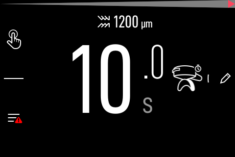
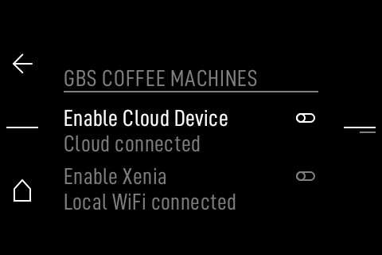

# Testing the E64 plugin against the QEMU grinder

The repository's Node tests use a synthetic WebSocket peer. This guide adds a
real integration pass against the from-SWU QEMU grinder, using the plugin's
actual `plugin.js` and a plain-WS bridge in front of the VM's TLS WSS.

> The bridge disables TLS verification **only for the disposable VM**. The
> plugin itself keeps its normal `ws`/`wss` behavior and deliberately has no
> self-signed bypass.

## 1. Start the VM

```sh
cd /path/to/mahlkoenig-e64ws-local-research
tools/virtual-grinder/from_swu.sh /tmp/vg-swu
VG_ROOT=/tmp/vg-swu/vm E64_FW_DIR=/tmp/vg-swu/fw \
  tools/virtual-grinder/vg up
VG_ROOT=/tmp/vg-swu/vm E64_FW_DIR=/tmp/vg-swu/fw \
  tools/virtual-grinder/vg status
```

Expected: `HTTPS 200`, `WSS RequestDriverStateResult`, and the HMI at
`https://127.0.0.1:28443/login.php`.



## 2. Mint a local WSS token

The vendor server trusts the `/tmp/tok_<64hex>` file used by the PHP login.
This is a disposable local token:

```sh
VG=/path/to/mahlkoenig-e64ws-local-research/tools/virtual-grinder/vg
export VG_ROOT=/tmp/vg-swu/vm E64_FW_DIR=/tmp/vg-swu/fw
TOKEN=$(python3 -c 'import secrets; print(secrets.token_hex(32))')
EXP=$(( $(date +%s) + 1800 ))
PAYLOAD="{\"sessionId\":\"plugin-vm\",\"token\":\"$TOKEN\",\"role\":\"Owner\",\"expires\":$EXP}"
B64=$(printf '%s' "$PAYLOAD" | base64)
"$VG" shell "echo $B64 | base64 -d > /tmp/tok_$TOKEN"
printf '%s\n' "$TOKEN" > /tmp/e64-vm-token
```

## 3. Run the plain-WS bridge

The VM WSS is TLS-only and uses the shipped self-signed certificate. This
test-only bridge accepts `ws://127.0.0.1:19997` and forwards it to
`wss://127.0.0.1:29997`:

```sh
python3 tools/ws-bridge.py 19997 29997
```

In Decaid, configure one instance:

```json
[{"id":"vm","name":"QEMU E64","scheme":"ws","host":"127.0.0.1","port":19997,"pollMs":0}]
```

and the matching token:

```json
{"vm":"<the token from step 2>"}
```



## 4. Run the real plugin integration

```sh
E64_VM_TOKEN=$(cat /tmp/e64-vm-token) node test/vm-integration.mjs
```

Observed on 2026-10-31:

```text
published {"state":"idle","observedSetting":"0 ddValueDum"}
machineInfo 200 {"grinderType":"E64 WS", ...}
config 200 {"adcOversampling":64,"adcTimeoutMs":1000,...}
ok disconnected=false
```

The `observedSetting` value is present only after a valid
`ddSensorFailed:false` state reply. To exercise it, run the vendor calibration
first:

```sh
"$VG" wss --json-message '{"type":"GrinderAction","msgId":91,"data":{"actionType":"CalibrateDdSensor"}}'
```

The state must then report `agsaStatus:"Normal"`, `ddSensorFailed:false` and a
safe integer `ddValueDum`.

## What this proves

- The real plugin parser, state normalizer and diagnostics paths work on a
  vendor `RequestDriverStateResult`, not just the mock.
- The setting observation is gated on the sensor-valid flag and is cleared when
  the value expires or the session is replaced.
- The plugin remains read-only: `start`, `setRpm`, motor and grind-setting
  handlers are absent.

It does **not** prove physical-hardware compatibility, self-signed `wss`
support (the plugin intentionally rejects it), or a real Decaid host install.
